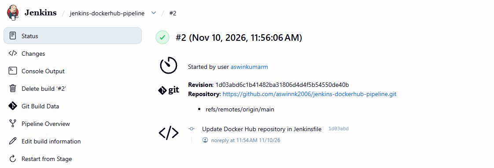
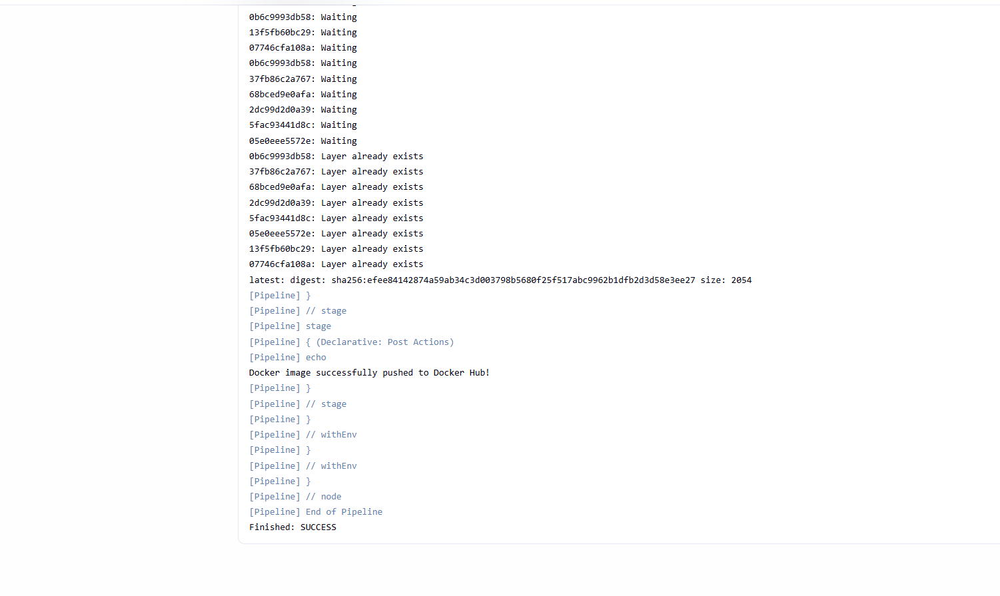
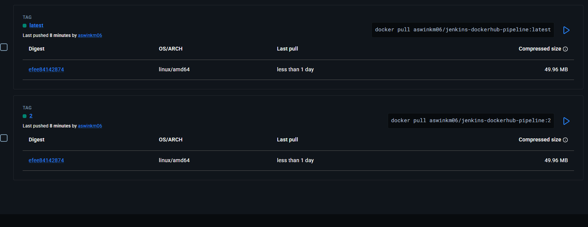

# Jenkins Docker Hub CI/CD Pipeline

## Project Description
This project demonstrates an automated CI/CD pipeline using Jenkins, Docker, GitHub, and Docker Hub.

Jenkins fetches source code from GitHub, builds a Docker image, and pushes it to Docker Hub.

## Technologies Used
- Jenkins
- Docker
- Docker Hub
- Git & GitHub
- Python Flask
- AWS EC2
- Ubuntu Linux

## CI/CD Workflow
1. Source code is stored in GitHub.
2. Jenkins fetches the source code.
3. Jenkins builds a Docker image.
4. Jenkins logs in to Docker Hub using stored credentials.
5. Jenkins pushes the image to Docker Hub.

## Docker Hub Repository

[View Docker Hub Repository](https://hub.docker.com/repository/docker/aswinkm06/jenkins-dockerhub-pipeline)

### Available Tags
- latest
- 2

### Pull Docker Image

```bash
docker pull aswinkm06/jenkins-dockerhub-pipeline:latest
```

## Screenshots

### Jenkins Build Success


### Jenkins Console Output


### Docker Hub Tags


## Project Outcome
Successfully implemented a Jenkins CI/CD pipeline to build Docker images and automatically push them to Docker Hub.